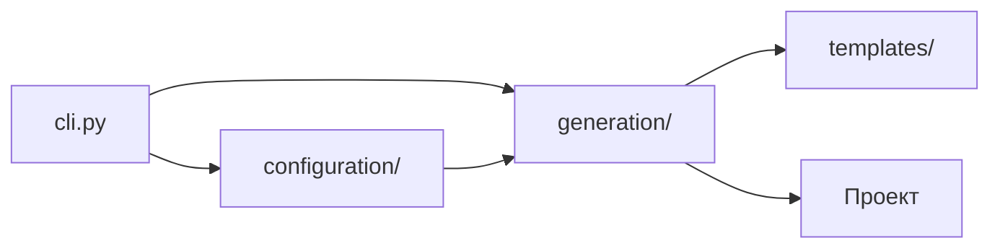

# Chaos

### Почему Chaos?

В греческой мифологии *хаос* - исходное состояние мира, из которого возник упорядоченный *космос*. Идея проекта - превратить пустую папку в готовую основу для разработки. Благодаря этому инструменты можно создать Python-проект с UV, Git, Dockerfile и корпоративным GitLab CI. При генерации разработчик сам выбирает FastAPI или скрипт шаблон будет установлен, а также какие дополнительные опции будут на проекте: PostgreSQL, pytest и OIDC для FastAPI.

### Установка и запуск

```sh
uv tool install chaos
chaos init
```

Для генерации нужны `uv` и `git`.

| Команда | Действие |
| --- | --- |
| `chaos init` | Создать папку с именем проекта. |
| `chaos init .` | Создать проект в текущей пустой папке. |
| `chaos init --config ./local-chaos.yaml` | Применить указанный файл переопределений. |

### Конфигурация и сборка

Встроенный [config.yaml](src/chaos/config.yaml) входит в wheel и исходный архив.

Без `--config` CLI ищет `$XDG_CONFIG_HOME/chaos/config.yaml` или `~/.config/chaos/config.yaml`. Выбранный файл применяется поверх встроенного YAML.

| Поле | Назначение и переопределение |
| --- | --- |
| `uv_index` | Индекс зависимостей создаваемого проекта. Заменяет адрес целиком. |
| `ruff_ignore`, `pylint_disable`, `bandit_skips` | Дополняют встроенные исключения без повторов. |
| `images.uv` | Образ приложения. Для репозитория без тега подставляется `:python{python}-trixie-slim`. |
| `images.python` | Необязательный отдельный базовый образ. В этом режиме `/uv` копируется из `images.uv`. |
| `images.postgres` | Образ PostgreSQL 18+ для Compose. |
| `images.ci` | Образ для `{ci_image}` во входах GitLab components. |
| `gitlab_stages`, `gitlab_components` | Порядок этапов и список компонентов. Каждый список заменяется целиком. |

В `images` переопределяются отдельные ключи. `{python}` подставляет выбранную ветку, например `3.13`. Для приватного UV index используйте `UV_INDEX_COMPANY_USERNAME` и `UV_INDEX_COMPANY_PASSWORD`.

Компонент GitLab задается полями `component` (адрес `host/group/project/component@version`), `inputs` и `branches`. Список веток преобразуется в `include.rules` для `CI_COMMIT_BRANCH`. Пустой список веток снимает это условие. Генератор формирует `stages` и `include` по YAML.

### Структура



| Путь | Ответственность |
| --- | --- |
| `cli.py` | Аргументы и сообщения CLI. |
| `configuration/` | Анкета, валидация YAML и переопределения. |
| `generation/` | Запуск UV/Git, рендеринг и GitLab CI. |
| `templates/` | Дерево результата. `src/package/` заменяется на `src/<имя пакета>/`. |

Сгенерированный README содержит команды запуска, переменные окружения, порядок добавления моделей и тестов, а для FastAPI - маршруты OpenShift и настройку OIDC.

Генератор обходит файлы `.jinja` в дереве шаблонов. Для условного файла
добавьте первой строкой, например, `{{ include_when(enabled=database) -}}`.
